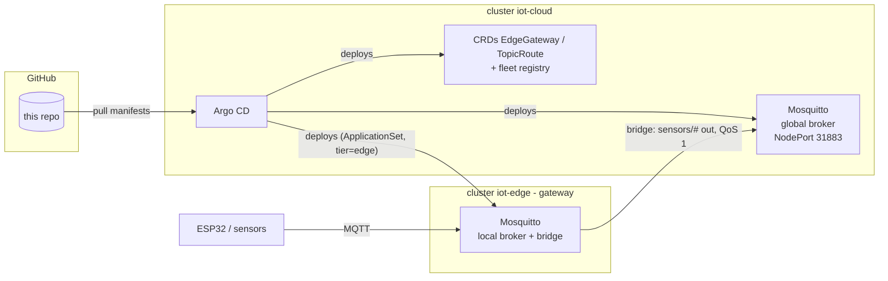
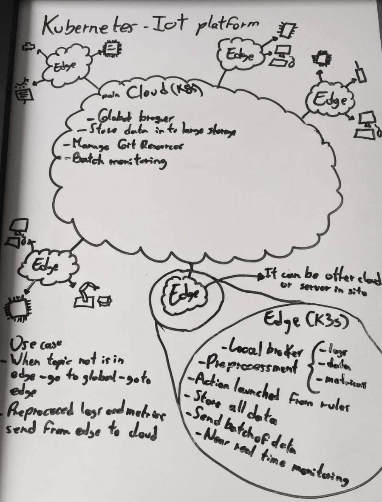

# Kubernetes IoT Platform

[](https://github.com/cvegac/kubernetes-iot-platform/actions/workflows/ci.yaml)

A cloud + edge IoT platform on Kubernetes, managed with GitOps. A central **cloud** cluster runs Argo CD and
the global MQTT broker; every **edge** gateway runs its own cluster with a local broker that forwards device
telemetry to the cloud. Adding a gateway means registering its cluster in Argo CD: it gets its workloads
automatically.

Everything runs locally on [kind](https://kind.sigs.k8s.io/) and the whole platform is rebuilt from scratch and
tested end to end in CI on every push.

## What works today

| Area | What it does | Verified by |
|---|---|---|
| Multi-cluster bootstrap | Two kind clusters (`iot-cloud`, `iot-edge`), Argo CD on the cloud one, edge registered as a remote cluster | `test/smoke.sh` |
| GitOps | App-of-apps; an `ApplicationSet` generates one MQTT broker Application per cluster labelled `tier=edge` | `test/smoke.sh` |
| Edge → cloud telemetry | Mosquitto on each edge bridges `sensors/#` to the cloud broker | A message published on the edge is received on the cloud |
| Platform API | `EdgeGateway` and `TopicRoute` CRDs with OpenAPI + CEL validation, fleet registry deployed via GitOps | Invalid resources are rejected by the API server |
| CI | shellcheck, kubeconform (including the custom CRDs) and the full platform on kind | [GitHub Actions](.github/workflows/ci.yaml) |

## Architecture



The edge cluster plays the role of a gateway (a Raspberry Pi or mini PC running k3s in a real deployment).
Microcontrollers like the ESP32 do not run Kubernetes: they are plain MQTT clients of the nearest gateway.

## Quick start

Requirements: Docker with **cgroup v2**, [kind](https://kind.sigs.k8s.io/) v0.33+, kubectl, Helm and git.

```bash
bootstrap/up.sh      # creates both clusters, installs Argo CD, registers the edge, applies the app-of-apps
test/smoke.sh        # end-to-end checks; exits non-zero if anything fails
bootstrap/down.sh    # deletes both clusters
```

Argo CD deploys from git, not from your working tree. `up.sh` uses the current branch by default; set
`REVISION` to deploy anything else (CI uses the exact commit SHA):

```bash
REVISION=main bootstrap/up.sh
```

Argo CD UI:

```bash
kubectl --context kind-iot-cloud -n argocd port-forward svc/argocd-server 8080:80
kubectl --context kind-iot-cloud -n argocd get secret argocd-initial-admin-secret -o jsonpath='{.data.password}' | base64 -d
```

> **Windows / Docker Desktop (WSL2):** since Kubernetes 1.35 the kubelet refuses to start on cgroup v1, and older
> WSL2 kernels still mount it. Update WSL first: on the 5.15 kernel, forcing cgroup v2 makes Docker Desktop's
> engine restart in a loop. Tested with WSL 3.0.5 (kernel 6.18).
>
> 1. Quit Docker Desktop, then in an admin terminal: `wsl --shutdown` and `wsl --update --web-download`.
> 2. Add this to `%UserProfile%\.wslconfig`:
>
>    ```ini
>    [wsl2]
>    kernelCommandLine = cgroup_no_v1=all
>    ```
>
> 3. Start Docker Desktop. `docker info --format '{{.CgroupVersion}}'` must print `2` (`up.sh` checks it).

## Platform API

Two custom resources describe the fleet declaratively (group `iot.cvegac.github.io/v1alpha1`):

```yaml
apiVersion: iot.cvegac.github.io/v1alpha1
kind: EdgeGateway
metadata: { name: iot-edge, namespace: iot-system }
spec:
  cluster: iot-edge            # cluster name in Argo CD
  hardware: kind               # kind | raspberry-pi | mini-pc
  arch: amd64
  uplink: { host: iot-cloud-control-plane, port: 31883 }
---
apiVersion: iot.cvegac.github.io/v1alpha1
kind: TopicRoute
metadata: { name: sensors-telemetry, namespace: iot-system }
spec:
  gateway: iot-edge
  topic: sensors/#
  direction: out               # out = edge -> cloud, in = cloud -> edge, both
  qos: 1
```

```console
$ kubectl --context kind-iot-cloud -n iot-system get egw,tr
```

Validation lives in the API server itself (OpenAPI schema + CEL rules), so there is no webhook to run:

| Rule | Mechanism |
|---|---|
| `topic` is a valid MQTT filter: `+` takes a whole level, `#` only as the last level | OpenAPI `pattern` |
| `qos` is 0, 1 or 2 | OpenAPI `minimum` / `maximum` |
| Routes towards the edge (`in`, `both`) cannot use `#` (the gateway would receive all cloud traffic) | CEL |
| A `raspberry-pi` gateway must be `arm64` | CEL |
| A route's `gateway` cannot change after creation | CEL transition rule (`self == oldSelf`) |

Each rule has a fixture in [`test/fixtures/invalid`](test/fixtures/invalid) declaring the error it expects; the
smoke test applies them with `--dry-run=server` and checks they are rejected for the right reason.

Today the API is the source of truth for the fleet, but the bridge configuration is still written by hand in
[`overlays/edge/mosquitto.conf`](workloads/mqtt-broker/overlays/edge/mosquitto.conf). Generating it from
`TopicRoute` objects is the job of the operator (see roadmap).

## Repository layout

```
bootstrap/          kind cluster configs, pinned versions, up.sh / down.sh
gitops/argocd/      Argo CD Helm values and the root Application (app-of-apps)
gitops/apps/        Helm chart with every Application/ApplicationSet; the git revision is a value
platform/iot-api/   CRDs and the fleet registry (EdgeGateway, TopicRoute)
workloads/          Kustomize base + cloud/edge overlays for the MQTT broker
test/               smoke test and CRD validation fixtures
.github/workflows/  CI
```

## Design decisions

- **Edge as a cluster, not as nodes of the cloud cluster.** Gateways live behind NAT on unreliable links. Separate
  clusters keep running when the uplink drops; the cloud only needs to reach them to deploy.
- **Push model in the lab, pull model for real hardware.** Here Argo CD pushes to the edge API server because
  both clusters share a Docker network. A real gateway behind NAT cannot be reached from the cloud, so the
  roadmap moves to a pull model (an agent on the gateway, or KubeEdge's edge-initiated tunnel).
- **The app-of-apps is a Helm chart.** The git revision is a single value, so CI deploys and tests the exact
  commit it is building instead of whatever a branch points to.
- **Cluster credentials never touch git.** `up.sh` builds the Argo CD cluster Secret on every bootstrap.
- **Mosquitto instead of a clustered broker.** A few MB of RAM and multi-arch images: the same broker runs on a
  Raspberry Pi gateway and in the cloud.
- **CEL instead of an admission webhook.** No extra deployment, certificates or failure mode for validation.
- **No cloud bill.** The proof is CI rebuilding everything from zero, not a cluster left running.

## Roadmap

- [ ] **Operator** that renders `TopicRoute` objects into the bridge config of each gateway and reports
      `EdgeGateway` status (`Connected` / `Offline`) from Argo CD's cluster connection state.
- [ ] **Real gateway**: Raspberry Pi with k3s (arm64), connected through a pull model; evaluate
      [KubeEdge](https://kubeedge.io/) for offline autonomy and device twins.
- [ ] **MQTT security**: TLS and per-device authentication (the lab broker allows anonymous clients).
- [ ] **Observability**: broker metrics, Prometheus and Grafana dashboards per gateway.
- [ ] **Storage**: time-series database for telemetry in the cloud.

## Original sketch

The whiteboard this project started from: a global broker in the cloud, k3s gateways with local brokers,
and preprocessed telemetry flowing from edge to cloud.


